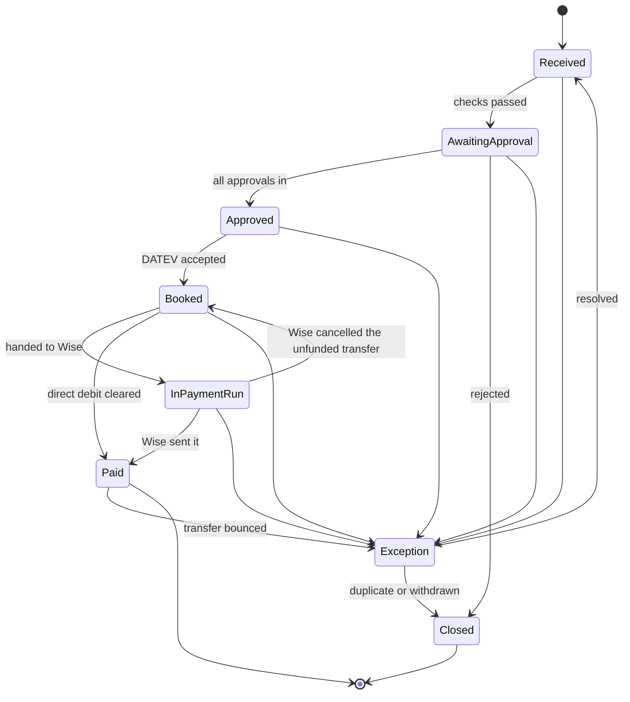

# The invoice case: design note

Covers: NF-01, NF-05, EX-01, EX-02, AP-08, BK-07, IN-10, BA-07 (also touches IN-08, IN-09, PY-06, PY-10, PY-11, PY-13, AR-07, BA-06, BA-08, AC-5, AC-8)

This note holds the detail behind [ADR 0005](../../adr/0005-invoice-case-audit-log-and-exception-queue.md). The ADR says what we decided. This note says how it works, so the developers on the skeleton (#8) and the first stories can build it without guessing.

[schema-sketch.sql](schema-sketch.sql) is a working PostgreSQL 16 sketch of the tables and rules below, and [checks.sql](checks.sql) proves the important rules hold. The skeleton story turns the sketch into Alembic migrations. Until then the sketch is the reference, not production code.

## 1. What a case is

A case is one business document or one bank transaction that ARGUS has to see through to the end. There are five kinds:

| Kind | Starts when | Ends when |
|---|---|---|
| Incoming invoice | Intake finds a supplier invoice in an email | Paid, or closed (rejected or duplicate) |
| Incoming credit note | Intake finds a supplier credit note | Offset in a payment run or cleared by the bank import |
| Outgoing invoice | Intake finds an invoice issued by Max ASP | The customer has paid in full |
| Outgoing credit note | Intake finds a credit note issued by Max ASP | Cleared by the bank import |
| Bank transaction | The monthly Wise import reads a transaction | Booked in DATEV |

Things that are **not** cases:

- **The email.** ADR 0003 already keeps one record per email. One email can hold several invoices, so it can create several cases (IN-08). Every case points back to its email.
- **Payment reminders.** A reminder is forwarded to Benjamin (IN-05). If ARGUS can match it to an open invoice case, it stamps `reminder_received_at` on that case and logs it, so the next payment run takes the invoice (PY-06). The reminder itself does not get its own case.
- **Other emails.** They only exist as an email record and are removed as ADR 0003 says.
- **Payment runs and payments.** They have their own tables (section 6) and point to the cases they pay.

### What a case holds

One `invoice_case` table holds what every kind shares. Kind specific detail lives in side tables (`bank_transaction` today, more as the stories need them).

| Field | Why |
|---|---|
| `kind`, `status` | What it is and where it is (NF-05) |
| `source_email_id` | Link to the email it came from, for the trace (AC-8) |
| Document links with SHA-256 | The original files in the locked store (ADR 0001) |
| `partner_account` | DATEV Kreditor or Debitor number once matched (PR-02, AR-03) |
| Document number, dates, net, VAT, gross, currency | Extracted data (PR-01). Money is stored as whole cents in a `bigint`, never as a float |
| `duplicate_key`, `duplicate_of` | Duplicate protection (IN-10), section 5 |
| `payment_hold` | Held back from payment runs (PY-10) |
| `reminder_received_at` | Always in the next run (PY-06) |
| `direct_debit` | Copied from the approver table, never put in a run (PY-13) |
| `datev_booking_ref` | The DATEV reference for reconciliation (BK-07) |
| `closed_reason` | Why a case ended without being paid |

Approval decisions get their own `approval` table (case, step first or second, approver, decision, comment, time) and each decision is also written to the audit log (AP-08).

## 2. Statuses

The seven statuses NF-05 asks for, plus **closed** for cases that end without being paid:

| Status | Meaning |
|---|---|
| Received | ARGUS has the document and is reading and checking it |
| Awaiting approval | Waiting for the vendor's approver, or for Benjamin's second approval above EUR 5,000 (AP-09). Which step is open is shown next to the status, not as its own status |
| Approved | All approvals are in. Booking starts at once (BK-01) |
| Booked | DATEV accepted the booking and returned a reference. The invoice is in the payment pool (PY-01) |
| In payment run | Part of a payment handed to Wise, waiting for Benjamin to release it |
| Paid | Wise reports the transfer as sent, or the bank import cleared it |
| Exception | Stopped and waiting in the exception queue for a person or for missing data |
| Closed | Ended without payment: rejected (AP-07), duplicate (IN-10), not an invoice after all, or withdrawn |

An exception always returns the case to the status it left, so the step that failed runs again. The diagram shows only "back to Received" to keep it readable.

### Which kinds use which statuses

| Kind | Path |
|---|---|
| Incoming invoice, incoming credit note | Received, Awaiting approval, Approved, Booked, In payment run, Paid |
| Incoming invoice paid by direct debit | Received, Awaiting approval, Approved, Booked, Paid (the bank import clears it, PY-13) |
| Outgoing invoice, outgoing credit note | Received, Booked, Paid (AR-02: never approval or payment run) |
| Bank transaction | Received, Booked |

A partial customer payment (BA-04) leaves an outgoing invoice in Booked with the open amount reduced. It becomes Paid only when the full amount has arrived.

### Rules the database enforces

These live in the database, so no bug in the application can get round them.

1. **Only listed moves are possible.** The table `case_status_transition` lists every allowed move per kind. A trigger refuses anything else, for example Approved straight to Paid.
2. **Every move names who made it.** Each transaction sets `argus.actor` to `system:<job>` or `user:<Entra object ID>`. Without it the change is refused.
3. **Every move is logged in the same transaction.** A trigger writes the audit event. If the audit write fails, the status change is undone too.
4. **Exception needs a reason.** A case can only move to Exception while it has an open exception in the queue, and can only leave it once that exception is resolved.
5. **An exception goes back to where it came from.** The exception remembers `resume_status`, and the case may only return there (or be closed).
6. **Two workers cannot move the same case at once.** Moves are written as `update ... where id = :id and status = :expected`. If another worker moved it first, nothing changes and the worker starts over.

## 3. The audit log

The audit log answers "what happened to this invoice, when, and who did it" for ten years (NF-01, AC-8).

### What gets logged

| Event | Written by |
|---|---|
| Case created, status changed (with booking reference when it is set) | Database trigger, automatically |
| Exception opened, exception resolved (with reason and resolution) | Database trigger, automatically |
| Email seen, stored, classified, routed, filed, forwarded, removed, purged (ADR 0003) | Intake |
| Document stored, with SHA-256 and storage path | Intake |
| Data extracted, vendor matched, checks run with their result | Processing |
| Approval requested, reminder sent, escalated, decided with comment (AP-03, AP-05, AP-08) | Approval |
| Booking sent, booking reference received or error (BK-06, BK-07) | Booking |
| Added to pool, held, released from hold, added to a run, transfer created, Wise status changed (PY-01 to PY-11) | Payment |
| Bank transaction imported, matched, cleared, booked by a rule, Benjamin's answer applied (BA-02 to BA-06) | Bank import |
| Payment reminder matched to a case (PY-06) | Intake |

Each event has: a running number, the time from the database clock, the case, email, statement, exception or payment run it belongs to, the event type, who did it (`system` plus job name, or `user` plus Entra object ID), the status before and after when it changed, and a small JSON with the details.

**What does not go in:** document content, full IBANs (only the last four characters and whether it matched), passwords, tokens or anything from Key Vault. The log is kept for ten years, so it holds only what the trace needs (GDPR, NF-03).

### Why nobody can change it

1. **The application cannot change history.** ARGUS connects as `argus_app`, which may only add and read audit events. `UPDATE`, `DELETE` and `TRUNCATE` are not granted, and a trigger refuses them even for roles that have the right.
2. **Changes behind the triggers are visible.** Each event carries the SHA-256 of the previous event plus its own content (a hash chain). Changing or deleting any old event breaks every link after it. `audit_verify()` walks the chain and names the first broken link. A daily job runs it and alerts Arita if it fails.
3. **A copy sits in the locked store.** Every night a job writes the previous day's events as a JSON lines file, plus the last hash of the day, into the locked blob store from ADR 0001. From then on, even someone with full database rights cannot rewrite that day without the difference showing.

Events are numbered one at a time under a short database lock, so the chain has no forks. At a few thousand events a day this costs nothing. The check in [checks.sql](checks.sql) and a load test with 8 parallel writers and 1,600 events kept the chain intact.

### Reading a trace (AC-8)

A `case_trace` view returns, in order, every event of the case, of the email it came from, of its exceptions, and of the payment run and bank transaction that paid it. QA runs it for every acceptance test case and checks that each step from receipt to the last status is there, with time and actor, without gaps. The screen for Arita and Benjamin shows the same list.

## 4. The exception queue

One queue holds everything ARGUS cannot finish on its own (EX-01). An exception belongs to exactly one thing: a case, an email (when there is no case yet, such as an uncertain classification) or a bank statement (balance difference).

### Reasons

The ten reasons from EX-02, plus three that other requirements need:

| Reason | Comes from | Belongs to | How it ends |
|---|---|---|---|
| Uncertain classification | IN-09 | Email | A person picks the category. ARGUS then routes the email and creates its cases |
| Unreadable document | IN-03 | Email or case | A person types in the data or asks the vendor for a better copy |
| Unknown vendor | VM-03, PR-02 | Case | **By itself** once the Kreditor exists in DATEV. A daily job checks again |
| Unknown customer | AR-03 | Case | **By itself** once the Debitor exists in DATEV |
| Vendor without approver | VM-02 | Case | **By itself** once Arita adds the approver to the approver table |
| Duplicate | IN-10 | Case | A person confirms (case closed as duplicate) or says it is not one (section 5) |
| IBAN mismatch | PR-05 | Case | **Only** by changing the IBAN in DATEV (VM-04), after which ARGUS checks again, or by rejecting the invoice. Nobody can accept the IBAN from the invoice |
| Invoice check failed (§14 UStG) | PR-03 | Case | A person asks the vendor for a corrected invoice, or accepts it with a comment |
| Booking error | BK-06 | Case | ARGUS retries a few times by itself, then a person fixes the cause in DATEV and retries |
| Unmatched bank transaction | BA-06 | Case | Benjamin's reply names the account. ARGUS books it and may save a rule |
| Bank balance difference | BA-08 | Statement | A person finds the difference. The import of that statement stays blocked until then |
| Number sequence gap or duplicate *(added)* | AR-07 | Case | A person confirms the gap is explained or fixes the numbering |
| Payment failed *(added)* | PY-11 | Case | A person checks the vendor's bank details in DATEV and puts the invoice back in the pool |
| Customer query *(added)* | Decision on #9 (E44) | Email | A person answers the customer and closes it |

### How an exception works

- An exception records the reason, a plain text detail a person can act on, when it was opened, the status the case was in (`resume_status`), and later who resolved it, when, and how.
- The same thing cannot have the same open reason twice. A unique index prevents it, so a job that runs again does not pile up copies.
- Opening an exception and moving the case to Exception happen in one transaction. Resolving it and moving the case back also happen in one transaction.
- Benjamin is told at once for the reasons the requirements name (BK-06, AR-03, VM-03, BA-06, BA-08) and gets the daily digest of everything still open (EX-03), grouped by reason, oldest first.
- Benjamin and Arita can resolve exceptions. Approvers cannot. Roles come from Entra groups (ADR 0001).
- An IBAN mismatch keeps the case out of every payment run until it is resolved, whatever its status was before. This is the fraud guard of PR-05 and must not have a shortcut.

## 5. Duplicate protection

### Invoices and credit notes (IN-10)

IN-10 says a duplicate is the same vendor, invoice number and amount. ARGUS builds a **duplicate key** from:

- direction (incoming or outgoing) and document type (invoice or credit note),
- the DATEV vendor account (or customer account for outgoing),
- the invoice number in a standard form: upper case, with spaces, `-`, `/`, `.` and `_` removed, so `RE-2026/0042` and `re 2026 0042` match,
- the gross amount in cents and the currency.

A unique index on the key makes the database the final judge, so two copies arriving at the same second cannot both get through.

The key can only be built once the vendor is matched. Until then the case sits in Received or in the Unknown vendor exception, and nothing is sent for approval. When the key is set and already exists, the new case goes to the exception queue as a duplicate, with `duplicate_of` pointing to the first case. It is never sent for approval, booked or paid. If a person decides it is not a duplicate, ARGUS stores the key with the case number added, logs who decided it and why, and carries on.

Two more checks, both cheap:

- **Same file again.** Every stored file has a SHA-256. The same file arriving a second time (for example forwarded twice) is flagged as a duplicate even before the vendor is known.
- **Same number, different amount.** Same vendor and number but a different amount is often a corrected invoice. It goes to the queue as a possible duplicate so a person decides. This goes slightly beyond IN-10, on purpose, because paying both would be the expensive mistake.

Outgoing invoice numbers also get the sequence check from AR-07 (gaps and repeats in Max ASP's own numbering).

### Bank transactions (BA-07)

- Each Wise transaction has an ID in the statement (`TransferWise ID` in the CSV, the bank reference in CAMT.053). ARGUS stores it with the Wise balance currency and a unique constraint on both. A repeated import adds nothing: existing rows are skipped and counted in the import log.
- If a file ever lacks an ID, ARGUS builds one from date, amount, currency, counterparty, reference and the running balance after the transaction. The running balance makes two identical payments on the same day still distinct.
- Each imported file is stored with its SHA-256. Importing the same file twice is spotted before any row is read.

### Bookings and payments

The same idea protects the outside systems:

- **DATEV.** Each booking carries the case number as its idempotency key, and `datev_booking_ref` is set once. A retry after a timeout first asks DATEV whether the booking with that key exists.
- **Wise.** A case can be in only one active payment at a time (unique index on the payment item while the payment is not cancelled). Each Wise transfer carries ARGUS's payment ID as `customerTransactionId`, so Wise itself refuses a second transfer for the same payment (ADR for Wise, #4).

## 6. Payment runs, in brief

The payment run story owns the detail. The case model only needs:

- `payment_run`: run date, type (mid month or month end), status (built, summary sent, handed over).
- `payment`: one per vendor and currency in a run, with the net amount after credit notes (PY-07), the Wise transfer ID and its status.
- `payment_item`: which cases a payment pays.

When a payment is created the cases move to In payment run. When Wise reports it sent, they move to Paid. When Wise cancels an unfunded transfer, they move back to Booked and wait for the next run.

## 7. Open questions

Posted on issue #7 for Arita. ARGUS is designed on the default in brackets until the answer comes.

1. If the DATEV booking of an approved invoice fails, should it still be paid in the next payment run? (Default: no. Only booked invoices go into a run, so every payment has a booking reference to reconcile against, BK-07. The booking error is in the exception queue and Benjamin is told at once.)
2. Do incoming credit notes need approval like invoices? (Default: yes, the same approver. AP-10 says nothing is approved automatically, and a wrong credit note would lower a payment to the vendor.)
